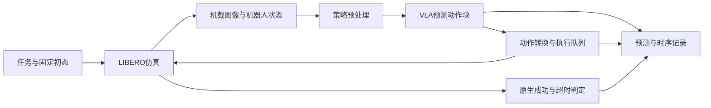

# 系统关系与追踪入口

目标闭环为：

图描述预期组件关系，不代表本仓库已经实现上述运行链路。首次rollout需要引用固定版本的实际函数，并用运行样本核验输入输出。

## 需要记录的接口

| 接口 | 首次运行的核对内容 |
| --- | --- |
| 任务初始化 | 任务名称、套件、初态索引、seed、重置后的目标是否已满足 |
| 图像 | 相机名称、顺序、形状、颜色通道、方向、裁剪/缩放、时间戳 |
| 状态 | 每个分量的意义、形状、单位、坐标系、采样时间与归一化 |
| 策略输入 | 任务文本、图像、状态及允许输入字段；不引入评测特权信息 |
| 策略输出 | 动作块形状、表示方式、尺度、归一化及预测对应时间 |
| 动作执行 | 预测长度与实际执行长度、重规划时刻、夹爪约定和控制频率 |
| 终止 | 原生成功、超时、外部诊断界限与基础设施错误分别记录 |

预处理与动作语义由所选检查点决定，不能跨模型只靠维度相同判断兼容。模型动作块长度与每次执行长度分别配置和记录。

## 上游源码入口

OpenVLA-OFT的[LIBERO说明](https://github.com/moojink/openvla-oft/blob/main/LIBERO.md)列出：

- `experiments/robot/libero/run_libero_eval.py`：评测主入口。
- `experiments/robot/libero/libero_utils.py`：LIBERO相关工具。
- `experiments/robot/openvla_utils.py`：策略相关工具。
- `vla-scripts/finetune.py`：训练入口，当前不运行。

这些是上游公开入口，本仓库尚未完成逐函数运行追踪。首次实现时以[源码版本记录](../configs/source_versions.json)中的已验证提交为准，而不依赖随时变化的main页面。

固定版本的静态核对记录见[接口源码检查表](interface-source-checklist.md)。其中明确区分源码确认、CPU 物理观测与尚未执行的策略链路。
